# LumenDisk

[English](README.md) | **Italiano**

**Apri, copia, modifica ed elimina i file dei dischi Linux e Windows (ext4, NTFS, FAT32, exFAT) direttamente dal Finder del tuo Mac.** Gratuito e open source. Senza macFUSE, senza estensioni del kernel, senza toccare la sicurezza dalla modalità di recupero.

[](https://github.com/giuseppegambino92/LumenDisk/actions/workflows/ci.yml)
[](https://github.com/giuseppegambino92/LumenDisk/releases/latest)
[](LICENSE)

<p align="center">
  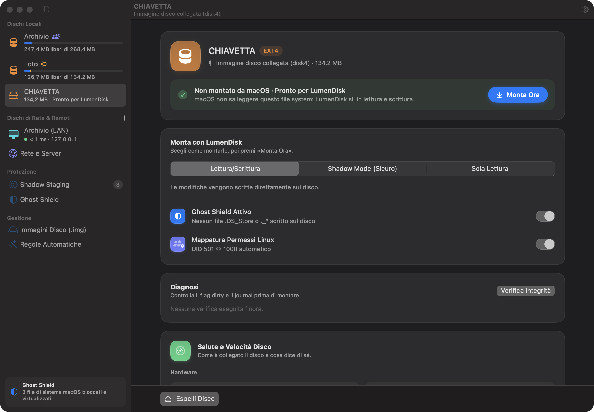
</p>

**[Scarica LumenDisk 1.1.0 per qualsiasi Mac (DMG universale)](https://github.com/giuseppegambino92/LumenDisk/releases/download/v1.1.0/LumenDisk-1.1.0-universal.dmg)** · macOS 14 Sonoma o successivo · firmata e notarizzata da Apple · [altri download](#download)

## I miei dati sono al sicuro?

- **Scegli tu come montare ogni disco**: **Sola lettura**, **Modalità Shadow** (ogni modifica resta in sospeso sul Mac: la controlli, poi scegli Commit o Rollback) oppure **Lettura/Scrittura**. Le regole di montaggio automatico permettono di impostarlo disco per disco.
- **Scritture a prova di crash**: un journal ordinato dei metadati, come ext4 `data=ordered`. Una modifica viene confermata a macOS solo quando è già nel journal sul Mac, quindi un crash o un'uscita forzata non fanno perdere nulla di confermato; dopo un'interruzione di corrente il disco viene riparato automaticamente al montaggio successivo.
- **I dischi "sporchi" vengono riconosciuti**: i volumi lasciati in stato non pulito da Windows o Linux (flag dirty, ibernazione, journal ext4 non riprodotto) vengono segnalati e si riparano con un clic.
- **Formattazione e scrittura di immagini sono protette**: si possono cancellare solo dischi esterni, schede SD e immagini disco. Il disco di avvio e i dischi interni vengono sempre rifiutati, ogni cancellazione va confermata dopo aver visto nome, dimensione e volumi del disco, e LumenDisk non esegue mai codice con privilegi (usa la richiesta di autorizzazione `authopen` di macOS).
- **Niente nel kernel**: tutto gira in spazio utente e la Protezione dell'integrità del sistema resta attiva.
- **Verificato con gli strumenti ufficiali**: 318 test unitari, 37 test end-to-end con montaggi reali controllati da `e2fsck`/`fsck` (anche con `kill -9` nel mezzo di scritture e commit), 16.000 immagini corrotte che non devono mai mandare in crash o bloccare l'app, e fuzzing. Vedi [Verifica](#verifica), il [modello di minaccia](SECURITY.md) e i [limiti noti](#limiti-noti) (per esempio, NTFS non è ancora stato verificato con `chkdsk` di Windows).

## In cosa è diverso

| | LumenDisk |
|---|---|
| macFUSE | non serve: i volumi passano dal client NFS già integrato in macOS |
| Estensione del kernel / sicurezza ridotta dalla modalità di recupero | nessuna: solo spazio utente, SIP resta attiva |
| Prezzo e licenza | gratuito, GPL-3.0 o successiva |
| Formati | lettura/scrittura ext2/3/4, NTFS, FAT12/16/32, exFAT; formatta con 11 filesystem; crea chiavette USB avviabili |

## Panoramica

LumenDisk monta su macOS dischi, schede SD e immagini disco **ext2/ext3/ext4, NTFS, FAT12/16/32 ed exFAT** in lettura e scrittura completa, così si comportano come qualsiasi altro disco nel Finder. Monta anche **server SFTP, condivisioni WebDAV/NAS, altri Mac della tua rete** e **file `.img` / `.iso` remoti** senza scaricarli. E **formatta unità** con undici filesystem e **crea supporti avviabili** per Windows, Linux e Raspberry Pi, come Rufus e Raspberry Pi Imager, direttamente sul Mac.

Tutto gira in spazio utente: un motore in Rust, con i suoi driver dei file system, presenta ogni volume a macOS tramite un server NFS privato in loopback, e il `mount_nfs` di macOS lo mette nel Finder. Nel kernel non si installa nulla e la Protezione dell'integrità del sistema resta attiva.

## Download

Scarica l'ultima versione da **[Releases](https://github.com/giuseppegambino92/LumenDisk/releases/latest)**:

| File | Per |
|---|---|
| **[LumenDisk-1.1.0-universal.dmg](https://github.com/giuseppegambino92/LumenDisk/releases/download/v1.1.0/LumenDisk-1.1.0-universal.dmg)** | **qualsiasi Mac**, Apple Silicon e Intel (consigliato) |
| [LumenDisk-1.1.0-arm64.dmg](https://github.com/giuseppegambino92/LumenDisk/releases/download/v1.1.0/LumenDisk-1.1.0-arm64.dmg) | solo Apple Silicon (M1, M2, M3, M4…) |
| [LumenDisk-1.1.0-x86_64.dmg](https://github.com/giuseppegambino92/LumenDisk/releases/download/v1.1.0/LumenDisk-1.1.0-x86_64.dmg) | solo Intel |
| [LumenDisk-1.1.0-universal.zip](https://github.com/giuseppegambino92/LumenDisk/releases/download/v1.1.0/LumenDisk-1.1.0-universal.zip) | l'app universale, in formato zip |
| [lumendisk-cli-1.1.0-macos-universal.tar.gz](https://github.com/giuseppegambino92/LumenDisk/releases/download/v1.1.0/lumendisk-cli-1.1.0-macos-universal.tar.gz) | lo strumento da riga di comando `lumendisk` |

Apri il DMG e trascina **LumenDisk** su **Applicazioni**. L'app è firmata con un Developer ID e notarizzata da Apple, quindi si apre come qualsiasi altra app. I checksum sono in [`SHA256SUMS.txt`](https://github.com/giuseppegambino92/LumenDisk/releases/download/v1.1.0/SHA256SUMS.txt).

Richiede macOS 14 Sonoma o successivo.

## Cosa fa

### Dischi e immagini
- **Lettura e scrittura di ext2, ext3, ext4, NTFS, FAT12/16/32 ed exFAT**, da USB, Thunderbolt e SD oppure da immagini disco (`.img`, `.raw`, `.iso`, `.ext4`, `.ntfs`, `.fat32`).
- **Immagini con più partizioni**: trascina un'immagine Raspberry Pi e monti `bootfs` (FAT32) e `rootfs` (ext4) affiancate, pronte da modificare prima di scriverle sulla scheda.
- **I dischi che macOS non sa leggere** compaiono come *"Non montato da macOS · Pronto per LumenDisk"* con il pulsante **Monta Ora**.
- **Dischi di prova**: crea con un clic un'immagine vuota ext4, NTFS, FAT32 o exFAT.

### Formattazione e supporti avviabili
- **Formatta qualsiasi unità** in **ext2/3/4, FAT16, FAT32 (anche oltre 32 GB), exFAT, NTFS, Btrfs, XFS, F2FS o UFS2**, con tabella delle partizioni **GPT, MBR o APM** oppure senza, con l'etichetta e la **dimensione dei cluster** che preferisci. Ogni filesystem è scritto da LumenDisk stesso, senza strumenti esterni, e verificato con quelli ufficiali (`e2fsck`, `fsck.vfat`, `fsck.exfat`, `ntfsfix`, `btrfs check`, `xfs_repair`, `fsck.f2fs`, `fsck_ffs` di FreeBSD).
- **Scrivi immagini** su chiavette USB e schede SD: `.iso`, `.img`, `.dmg`, `.vhd`, anche compresse (`.xz`, `.gz`, `.bz2`, `.zst`, `.zip`). L'immagine viene confrontata con il suo SHA-256 prima di scrivere, e alla fine l'unità viene riletta e confrontata.
- **Supporti di installazione di Windows 11, 10, 8.1 e 7**: FAT32 con `install.wim` diviso in parti `.swm` quando supera i 4 GB, oppure NTFS con UEFI:NTFS. Entrambi si avviano in UEFI (anche con Secure Boot, su NTFS grazie a UEFI:NTFS firmato Microsoft) e sui PC BIOS.
  - **Opzioni per Windows 11**: salta i controlli di TPM 2.0, Secure Boot, RAM e CPU; crea un account locale senza account Microsoft né rete; salta le domande sulla privacy; imposta lingua e fuso orario. Puoi anche usare un tuo `autounattend.xml`.
- **Linux e BSD**: la **modalità DD** scrive ISO ibride e immagini byte per byte. La **modalità ISO** copia i file su un'unità FAT32 che si avvia in UEFI e, per le ISO basate su SYSLINUX, anche da BIOS, con una **partizione di persistenza** facoltativa per i sistemi live Ubuntu (casper) e Debian/Kali (live-boot).
- **Raspberry Pi**: dopo aver scritto Raspberry Pi OS o Ubuntu, imposta nome host, utente e password, SSH (anche con chiavi), Wi-Fi con il suo paese, lingua, fuso orario e tastiera, come fa Raspberry Pi Imager (firstrun o cloud-init, scelto in base all'immagine).
- **Utilità**:
  - **Checksum**: SHA-256, SHA-1 e MD5 di immagini e unità, confrontati con un valore incollato o con un file `SHA256SUMS` accanto all'immagine.
  - **Cancellazione sicura**: zeri, casuale, DoD 5220.22-M (3 o 7 passaggi) o Gutmann (35 passaggi).
  - **Dottore delle tabelle delle partizioni**: trova e ripara tabelle GPT e MBR danneggiate, e converte MBR in GPT e viceversa senza spostare i dati.
- **Sicurezza**: si possono scrivere solo unità esterne, schede SD e immagini disco. Il disco di avvio e le unità interne sono sempre rifiutati, e ogni cancellazione va confermata dopo aver visto nome, dimensione e volumi dell'unità. Per scrivere su un'unità si usa la richiesta di autorizzazione di macOS (`authopen`): LumenDisk non esegue mai codice con privilegi.

### Protezione
- **Ghost Shield**: `.DS_Store`, i file AppleDouble `._*`, `.Spotlight-V100`, `.Trashes` e `.fseventsd` restano in un archivio locale e non vengono mai scritti sul disco Linux o Windows. Il Finder funziona come sempre.
- **Shadow Mode**: ogni modifica resta sul Mac. Controlli l'elenco dei file aggiunti, modificati ed eliminati, poi **Applica su Disco** oppure **Scarta Modifiche** e il disco resta intatto. Le modifiche in sospeso vengono registrate in un journal sul Mac, quindi sopravvivono a un crash, a un'uscita forzata, a un blackout o alla chiusura dell'app: la volta dopo che colleghi il disco LumenDisk ti propone di riprenderle. Se l'applicazione si interrompe (disco scollegato, disco pieno, crash), riparte da dove si era fermata; non viene annullata. Se nel frattempo il disco è stato modificato altrove, le modifiche salvate si possono solo scartare. Sui volumi SFTP, WebDAV e LAN funziona allo stesso modo: la sessione è legata all'indirizzo del server (mai a una password) e torna quando ti ricolleghi in Shadow Mode; **Applica su Disco** finisce solo quando il server ha ricevuto tutte le modifiche, e se sul server è cambiato qualcosa che la sessione aveva letto, le modifiche si possono solo scartare.
- **Niente di confermato va perso**: in lettura/scrittura e in Shadow, LumenDisk conferma una modifica a macOS solo quando è nel suo journal sul Mac. Se LumenDisk va in crash, viene chiuso forzatamente o terminato, non si perde nulla di confermato: nessuna cartella o file creato, rinominato o eliminato, nessun file chiuso o salvato con `fsync`. In caso di blackout sono al sicuro i file chiusi o salvati con `fsync` (contenuto, creazione e rinomine, `F_FULLFSYNC` prima che close() ritorni) e ogni altra modifica più vecchia di circa 100 ms.
- **Scritture a prova di blackout**: un journal ordinato dei metadati (come `data=ordered` di ext4). Se il Mac si spegne a metà copia, il disco viene riparato da solo al montaggio successivo. Le copie grandi vengono scritte una volta sola (0,05 % di journal in più su ext4).
- **Ponte dei permessi Linux**: i file del tuo utente Linux (per esempio `1000:1000`) sul Mac risultano tuoi, e i file nuovi vengono salvati con il proprietario Linux.
- **Riparazione flag "dirty" e journal**: riconosce i volumi lasciati in sospeso da Windows o Linux (flag dirty, ibernazione, journal ext4 non applicato) e li ripara con un clic.
- **Chi blocca il disco?**: mostra le app che tengono occupato un volume e lo espelle in sicurezza.

### Rete e archivi remoti
- **SFTP, WebDAV e NAS** che non bloccano mai il Finder: quando cade la rete, cartelle e file già aperti arrivano dalla cache locale in meno di un millisecondo, le scritture vanno in coda e tutto si sincronizza al ritorno della connessione, anche dopo aver chiuso l'app.
- **Immagini disco remote** via HTTP o SFTP: un'immagine Raspberry Pi da 600 MB si monta in meno di mezzo secondo scaricandone meno dell'1 %. Le modifiche restano sul Mac e il file remoto non viene mai toccato.
- **Condividi un disco con un altro Mac** della rete con un clic: scoperta con Bonjour, codice di abbinamento, cifratura TLS 1.3 con certificato verificato.
- **Ricevi e invia via Wi-Fi**: inquadra un codice QR con qualsiasi telefono per caricare o scaricare file direttamente sul disco esterno, protetto da PIN.

### Strumenti
- **Salute e Velocità Disco**: velocità reale di lettura, scrittura e accesso casuale 4K in circa 3 secondi, con un giudizio chiaro ("Veloce per video 4K"), più stato SMART, tipo di collegamento e SSD/HDD.
- **Icona nella barra dei menu** con tutti i dischi, il contatore di Ghost Shield, l'apertura nel Finder, la condivisione via QR e **Espelli Tutti in Sicurezza**.
- **Regole automatiche** per ogni disco: lettura/scrittura, sola lettura o Shadow, Ghost Shield e mappatura UID.
- **Interfaccia in italiano e inglese**, che puoi cambiare in qualsiasi momento.

## Screenshot

| | |
|---|---|
| 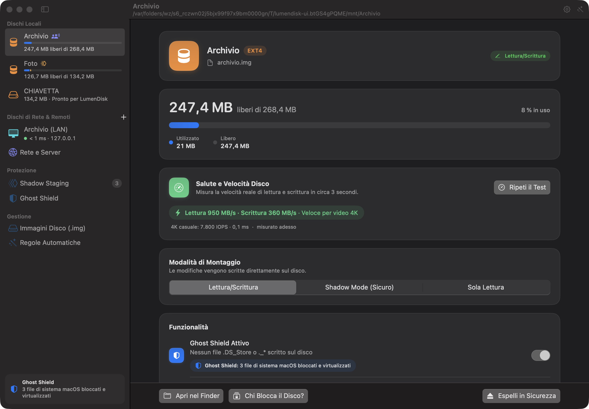 |  |
| **Volume**: capacità, test di velocità, modalità di montaggio, Ghost Shield | **Chiavetta USB** che macOS non legge, pronta da montare |
| 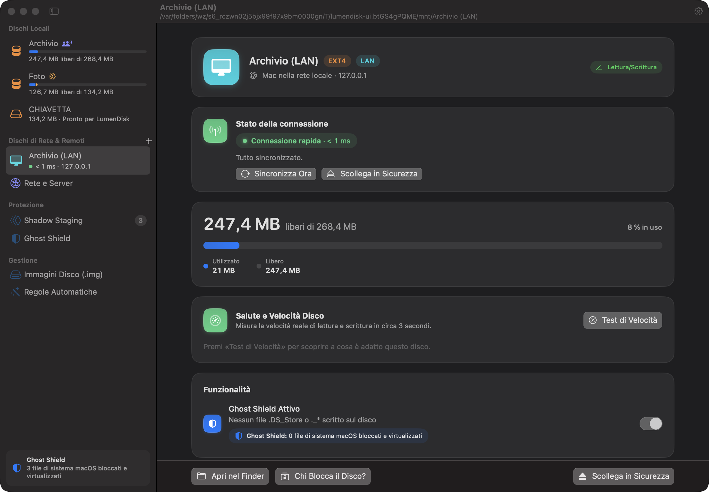 | 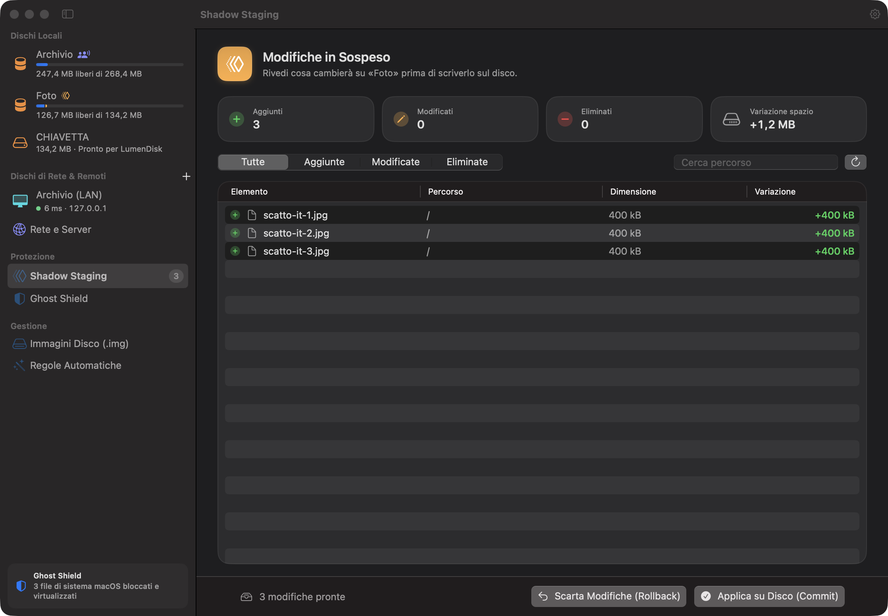 |
| **Disco di rete** con stato della connessione e coda offline | **Shadow Staging**: controlla le modifiche, poi Applica o Scarta |
| 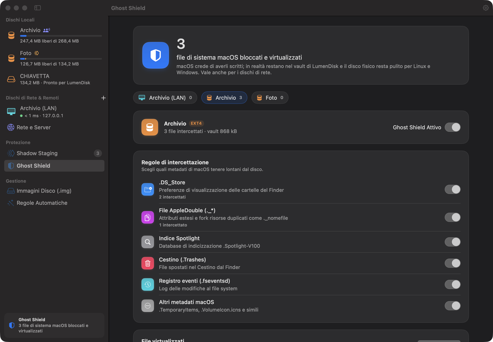 | 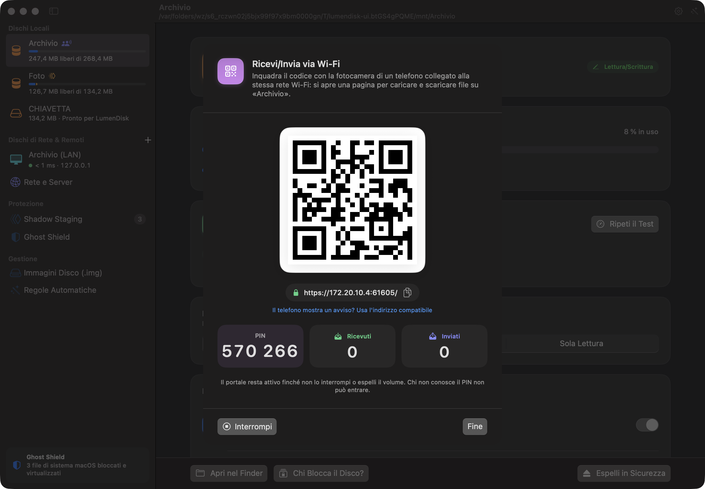 |
| **Ghost Shield**: i file di sistema di macOS restano fuori dal disco | **Ricevi/Invia via Wi-Fi**: codice QR e PIN |
| 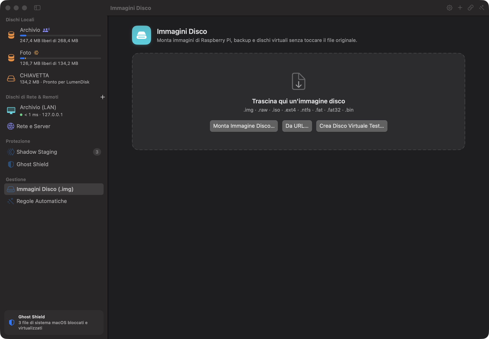 | 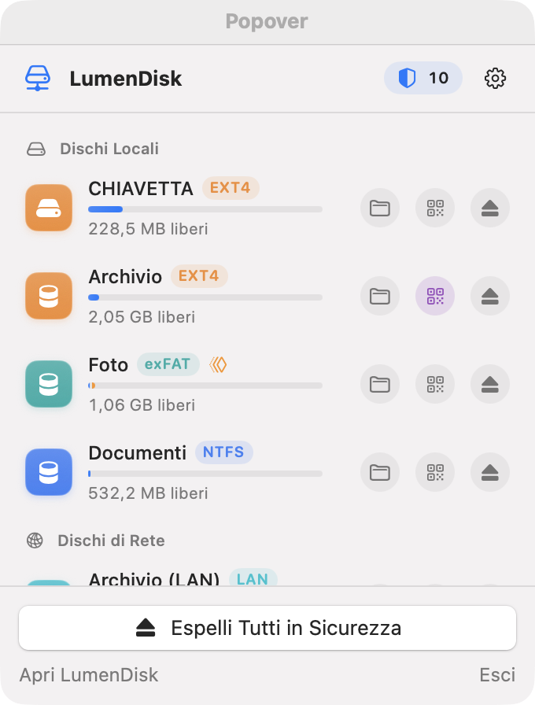 |
| **Immagini disco**: trascina, da URL, crea un disco di prova | **Barra dei menu** |

### Crea & Formatta

| | |
|---|---|
| 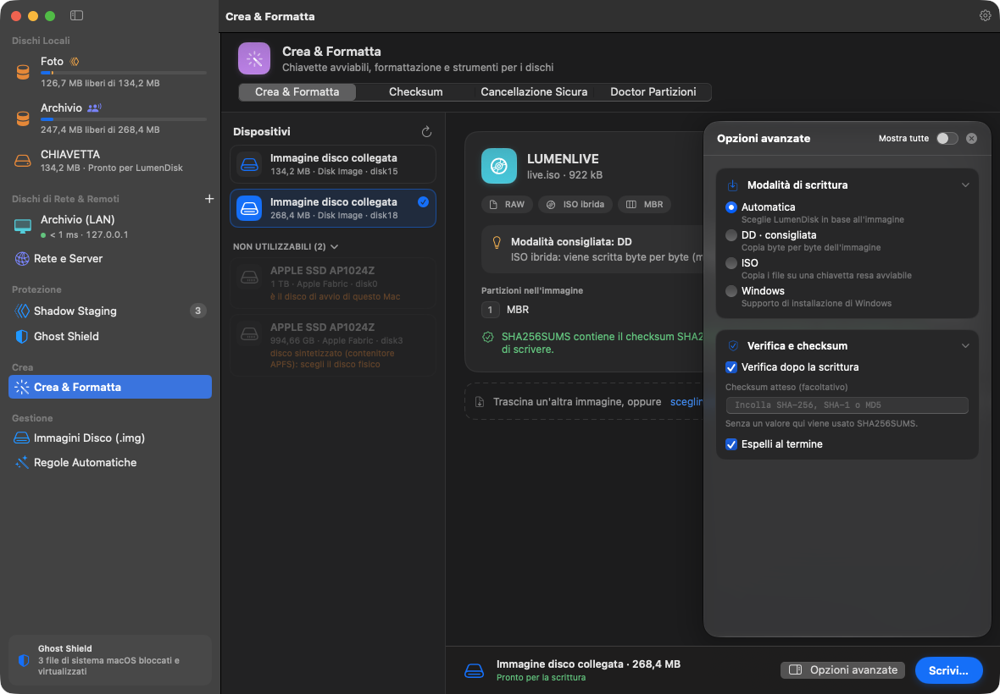 | 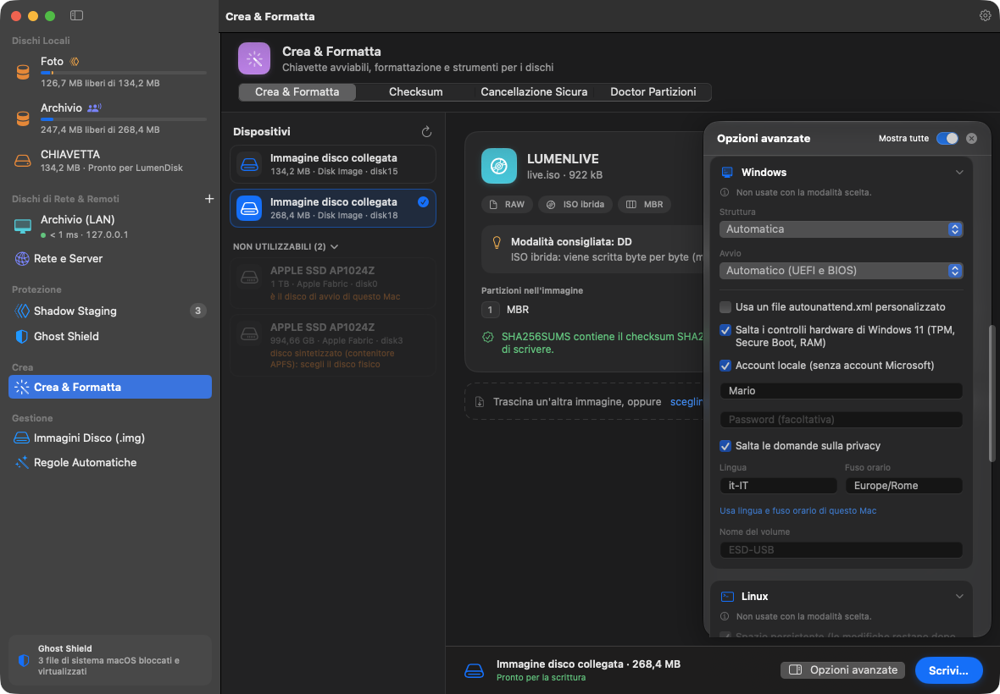 |
| **Scrivi un'immagine**: trascinala, LumenDisk la analizza, consiglia la modalità DD o ISO e la verifica con `SHA256SUMS` | **Supporti Windows**: salta i controlli hardware di Windows 11, account locale, niente domande sulla privacy, lingua e fuso orario |
| 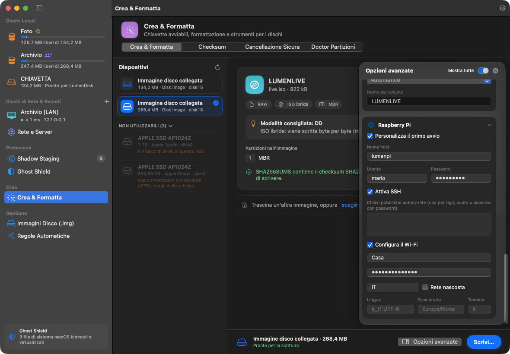 | 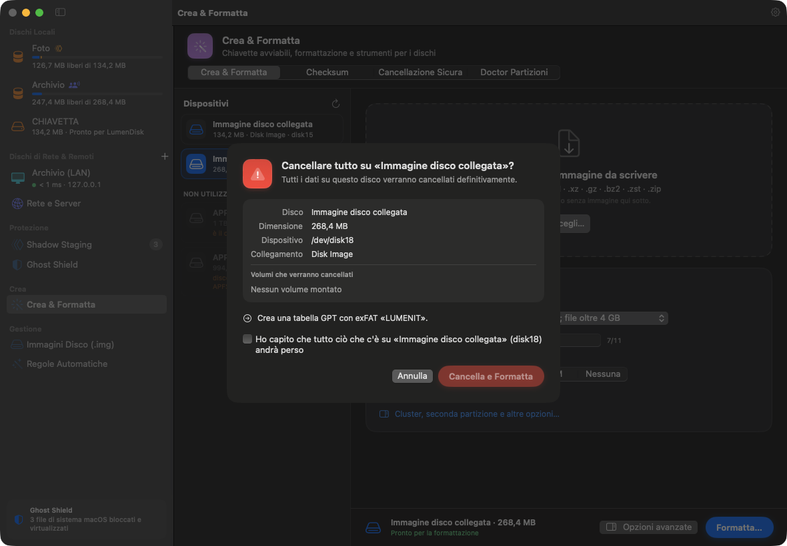 |
| **Raspberry Pi**: nome host, utente, SSH, Wi-Fi, lingua, come Raspberry Pi Imager | **Ogni cancellazione va confermata** dopo aver visto nome, dimensione, dispositivo e volumi dell'unità |
| 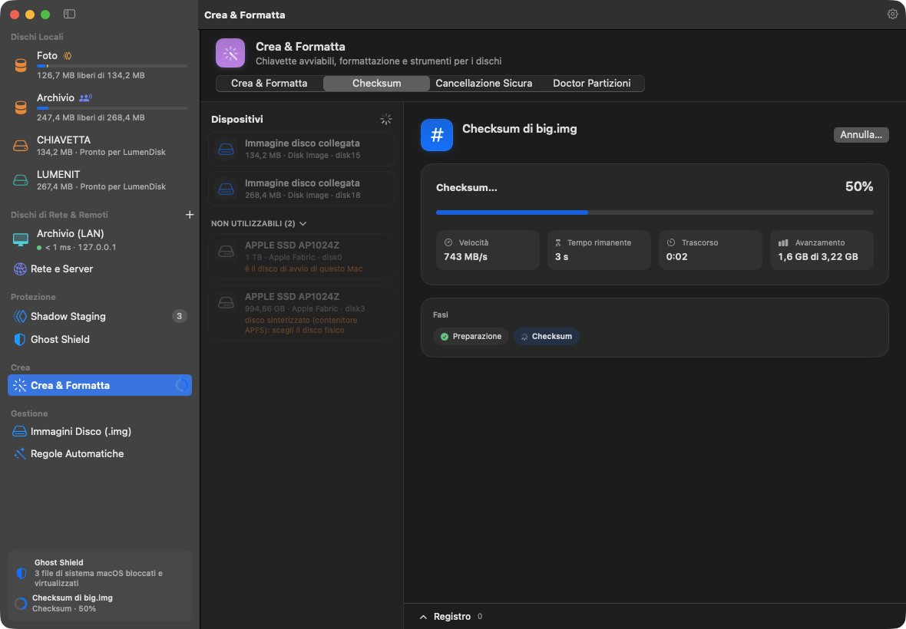 | 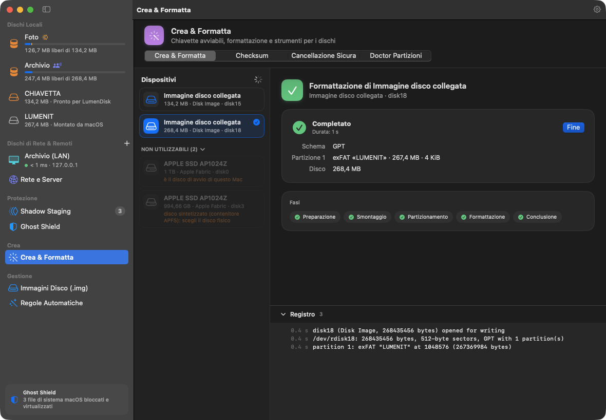 |
| **Avanzamento in tempo reale**: velocità, tempo rimanente, fasi; le operazioni continuano anche a finestra chiusa | **Risultato**: tabella delle partizioni e filesystem scritti, fasi e registro |
| 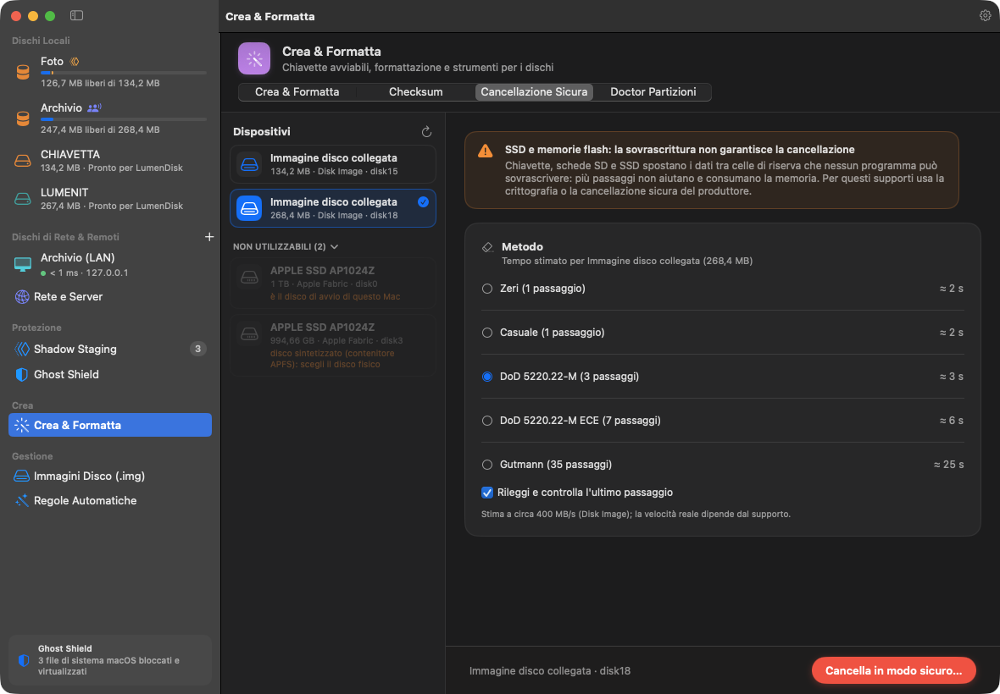 | 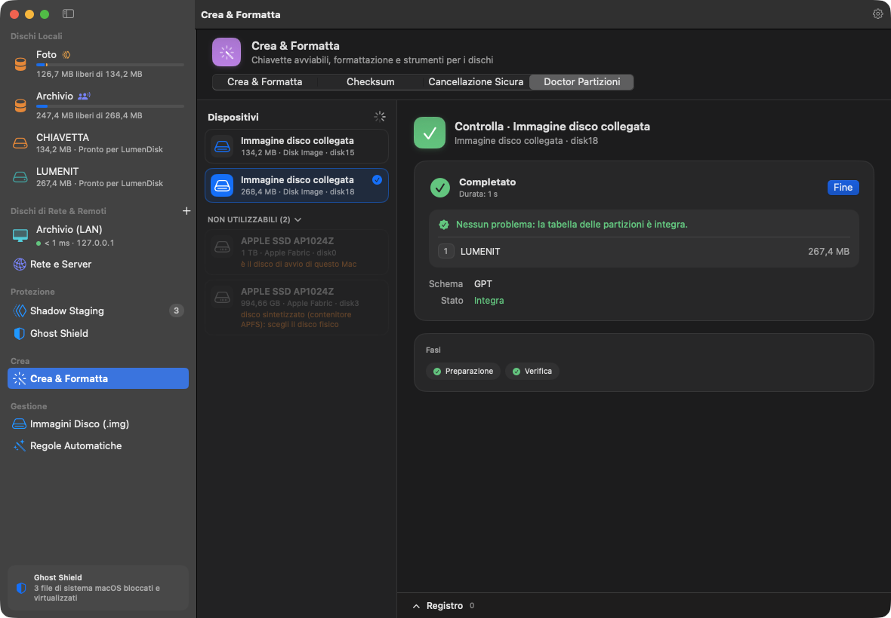 |
| **Cancellazione sicura**: zeri, casuale, DoD 5220.22-M, Gutmann, con il tempo stimato | **Dottore delle tabelle delle partizioni**: controllo, riparazione, MBR ⇄ GPT |

Tutti gli screenshot vengono dal motore reale con volumi reali (vedi [Verifica](#verifica)).

## Compilare dai sorgenti

Servono Xcode con Swift 6 e [rustup](https://rustup.rs). I target macOS `aarch64` e `x86_64` vengono aggiunti in automatico.

```sh
scripts/build_and_verify.sh                                 # compila ed esegue tutti i test
INSTALL=1 scripts/build_and_verify.sh                       # installa anche la build di sviluppo in /Applications
SKIP_E2E=1 SKIP_UI=1 SKIP_FUZZ=1 scripts/build_and_verify.sh  # solo compilazione + test unitari e immagini corrotte
```

Lo script produce `dist/LumenDisk.app` (universale, firma ad-hoc) e `build/bin/lumendisk` (riga di comando). I test end-to-end richiedono Docker; la verifica dell'interfaccia apre finestre dell'app.

Questa build di sviluppo ha una firma ad-hoc. macOS mostra la tabella dei socket di sistema solo alle app firmate con un Developer ID, quindi una build così non può controllare chi si collega al suo server NFS locale. Per questo rifiuta di montare, a meno di impostare `LUMENDISK_ALLOW_UNVERIFIED_LOOPBACK=1`; gli script di test lo impostano da soli. Vedi [SECURITY.md](SECURITY.md).

Per pubblicare, `scripts/release.sh` firma quel pacchetto con un Developer ID, lo fa notarizzare e prepara in `dist/release/` i DMG, lo zip e l'archivio della riga di comando. Usa l'account Apple collegato a Xcode, quindi non serve configurare certificati o password.

Lo strumento da riga di comando crea, esamina e monta immagini:

```sh
lumendisk mkfs ext4 prova.img 512 MioDisco
lumendisk inspect raspios.img
lumendisk mount raspios.img --partition 2 --mode shadow
```

### Fuzzing

Una chiavetta USB o un'immagine possono essere costruite apposta per essere malformate, quindi ogni volume è trattato come un input non fidato. `scripts/fuzz.sh [secondi per target]` esegue i target libFuzzer guidati dalla copertura (`core/fuzz`: ext4, NTFS, FAT, exFAT e il parser MBR/GPT). Ogni input è un'immagine intera che viene montata in sola lettura e in lettura/scrittura, esplorata, modificata e riparata. I semi sono immagini create dal mkfs di LumenDisk e, se Docker è disponibile, da `mkfs.ext4 -d`, `mkfs.vfat` + `mcopy`, `mkntfs` + `ntfscp` e `mkfs.exfat`. Servono una toolchain nightly e cargo-fuzz (`rustup toolchain install nightly`, `cargo install cargo-fuzz`). Se mancano, lo script lo segnala e si salta. `build_and_verify.sh` lo esegue per 30 s per target quando sono installati (`SKIP_FUZZ=1` lo salta). I crash vengono salvati in `core/fuzz/artifacts/`. Prima di correggerne uno, `cargo run --profile robust --example fuzz_seeds -- core/tests/corrupt_regressions --regression <target> <file>` lo trasforma in un caso di regressione minimizzato (pochi byte modificati in un'immagine seme riproducibile) che gira a ogni `cargo test`.

## Come funziona

```
Finder / qualsiasi app
      │  client NFS di macOS (presente in ogni Mac)
      ▼
mount_nfs 127.0.0.1:/<export casuale>  →  ~/Volumes/<Nome>
      │
      ▼  server NFSv3 privato in loopback, uno per volume
┌──────────────────────────── lumendisk-core (Rust) ────────────────────────────┐
│ Ghost Shield → Shadow → ponte UID → journal ordinato → ext4 / NTFS / FAT / exFAT │
│                                     └→ oppure un archivio remoto: SFTP · WebDAV · LAN │
└────────────────────────────────────────────────────────────────────────────────────┘
      │  file immagine, /dev/diskN (tramite authopen), oppure byte via HTTP/SFTP
```

- **I driver dei file system** sono scritti da zero in Rust: extent tree, directory htree, `metadata_csum` e replay del journal jbd2 per ext4; MFT, indici B-tree, reparse point e LZNT1 per NTFS; nomi lunghi VFAT per FAT; bitmap di allocazione e tabella up-case per exFAT.
- **Il server in loopback** ascolta solo su 127.0.0.1. Usa un percorso di export casuale, accetta un solo MOUNT e mette un segreto a 128 bit in ogni file handle, e rifiuta le chiamate di altri utenti.
- **L'app Swift** parla con il motore tramite una piccola interfaccia C (`core/include/lumendisk_ffi.h`) e usa DiskArbitration per scoprire i dischi.

## Verifica

`scripts/build_and_verify.sh` compila tutto e verifica il funzionamento contro strumenti ufficiali e indipendenti eseguiti in Docker (e2fsprogs, ntfs-3g, dosfstools, exfatprogs, btrfs-progs, xfsprogs, f2fs-tools, wimlib, OpenSSH, Apache, QEMU con SeaBIOS e OVMF, e una VM FreeBSD 14.5). A ogni push e pull request la [CI](.github/workflows/ci.yml) lo esegue su un Mac di GitHub senza Docker e fuzzing: build universale, test unitari, race della cache, immagini corrotte, server LAN, avvio dell'app e schermate dell'interfaccia. Le suite end-to-end richiedono Docker, montaggi reali e dischi collegati, quindi girano in locale.

| Suite | Cosa dimostra |
|---|---|
| Unitari (318) | ogni driver supera la stessa suite di conformità; replay del journal dopo un crash; Ghost Shield; Shadow, compresi il replay del journal di sessioni casuali, journal troncati, un crash simulato a ogni passo dell'applicazione su ext4, FAT32, exFAT e NTFS (prima e subito dopo ogni passo, con un checkpoint troncato, e di nuovo durante le riprese) e modifiche fatte al disco altrove; un `fsync` della cartella che fallisce mentre una sessione viene eliminata (dopo un crash torna intera, mai a metà); group commit; race della cache remota; un panic di un driver mette fuori uso solo il suo volume, subito (EIO), senza avvelenare i lock; tabelle delle partizioni, ogni mkfs, lettore ISO 9660 / UDF, divisione dei WIM, decodificatori di immagini, crypt SHA-512, operazioni e regole di sicurezza sui dispositivi |
| ext4 contro e2fsprogs (5) | volumi creati con il vero `mkfs.ext4` (64bit, flex_bg, metadata_csum, orphan_file) modificati da LumenDisk restano puliti per `e2fsck`; replay jbd2 di una transazione reale |
| End-to-end (37) | `mount_nfs` reale + client NFS del Finder su ext4 / FAT32 / exFAT / NTFS; Shadow, compreso il `kill -9` del server con modifiche in sospeso e a metà applicazione, poi `e2fsck`; nessuna finestra di perdita: `kill -9` nell'istante in cui un mkdir / create / rename / unlink / rmdir / close / fsync ritorna, in Shadow e in lettura/scrittura su ext4 e FAT32, senza perdere nulla di confermato e con `fsck` pulito; Shadow su un vero dispositivo a blocchi (`/dev/diskNs1`, `/dev/rdiskN`): `kill -9` senza attesa e a metà applicazione, ripresa, `e2fsck`; Shadow su SFTP, WebDAV e condivisioni LAN: `kill -9`, ripristino, applicazione verificata sul server, modifiche fatte sul server rilevate; riparazione; immagine Raspberry Pi; symlink NTFS; sicurezza del loopback; immagini via HTTP Range; condivisione LAN offline; SFTP; blackout con un file da 64 MB; WebDAV Apache con coda offline tra riavvii; TLS attraverso un proxy intercettatore (niente in chiaro); un dispositivo a blocchi reale collegato |
| Formattazione e supporti avviabili (57) | ogni filesystem su GPT / MBR / APM / nessuna tabella, controllato dal suo `fsck` ufficiale e montato dal kernel Linux (UFS2 da FreeBSD 14.5); XFS, F2FS e UFS2 confrontati byte per byte con `mkfs.xfs`, `mkfs.f2fs` e `newfs`; dottore delle tabelle verificato con `sgdisk` e `parted`; ogni formato di immagine scritto su immagini disco collegate e riletto; supporti Windows con WIM divisi come fa wimlib, avviati in QEMU (SeaBIOS, OVMF, Secure Boot); Alpine e Debian live in modalità ISO avviate, con la persistenza che sopravvive a uno spegnimento; Raspberry Pi OS e Ubuntu personalizzati e avviati con login; ogni metodo di cancellazione |
| Immagini corrotte (16.000 varianti + regressioni) | volumi validi e popolati (ext2/ext4 con extent, htree, symlink e una transazione del journal in sospeso; NTFS con blocchi di indice, liste di attributi, file compressi LZNT1 e reparse point; FAT12/16/32; exFAT) alterati privilegiando i metadati, più tabelle MBR/GPT alterate e un caso di regressione per ogni bug trovato: ogni variante viene montata in sola lettura e in lettura/scrittura, esplorata, modificata e riparata senza panic, senza blocchi (limite di 20 s) e senza allocazioni oltre 1 GiB. Un panic di un driver disattiva solo quel volume (da lì in poi EIO) e non lo blocca mai. `LUMENDISK_CORRUPT_CASES` aumenta il numero di casi |
| Server LAN (22) · SFTP (4) | protocollo WebDAV/portale su TLS; autenticazione, timeout e riconnessioni con OpenSSH |
| Interfaccia · unitari Swift (19) | ogni schermata guidata dal motore reale con volumi reali, in italiano e inglese |

## Sicurezza

Il modello delle minacce è descritto in [SECURITY.md](SECURITY.md). Copre:

- chi può raggiungere il server NFS locale e perché `AUTH_SYS` è sicuro solo dietro un filtro delle connessioni fail-closed;
- il portale Wi-Fi e la condivisione LAN;
- gli archivi remoti e i volumi non affidabili.

## Limiti noti

- I volumi compaiono in `~/Volumes/<Nome>`, perché un'app senza diritti di amministratore non può creare cartelle in `/Volumes`.
- I volumi remoti non possono aprire offline file mai aperti mentre c'era la rete; falliscono subito invece di restare bloccati.
- Sui telefoni, l'indirizzo HTTPS del portale Wi-Fi mostra una volta un avviso sul certificato. Per i telefoni che lo rifiutano si può attivare un indirizzo HTTP non cifrato, dopo un avviso esplicito. È spento per impostazione predefinita e, finché resta attivo, PIN e file viaggiano in chiaro sulla rete.
- NTFS: i file compressi e cifrati sono in sola lettura; non ancora verificato con `chkdsk` di Windows.
- I volumi ext4 con inline_data, cifratura, casefold, bigalloc, quota o verity vengono montati in sola lettura.
- La maggior parte degli adattatori USB nasconde i dati SMART a macOS; in quel caso LumenDisk lo dice chiaramente.
- Ogni close() o `fsync` di un file scritto attende un `F_FULLFSYNC` (circa 4 ms su un SSD Apple; le richieste concorrenti ne condividono uno), quindi copiare 1.500 file piccoli con `cp` richiede circa 9 s invece di circa 2 s. I file grandi ne risentono poco (150 MB: 0,23–0,32 s invece di 0,20–0,35 s). In caso di blackout possono mancare le modifiche più recenti di circa 100 ms non ancora chiuse o salvate con `fsync`. Sui volumi SFTP, WebDAV e LAN la garanzia è quella della cache remota, non questa.
- Shadow Mode: un'applicazione delle modifiche già iniziata non si può annullare; la garanzia è che si può sempre portare a termine. Il controllo che il disco non sia stato modificato altrove guarda i metadati del file system e i file toccati dalla sessione, quindi una modifica fatta altrove che non cambia né gli uni né gli altri può sfuggire; non viene fatto mentre si completa un'applicazione interrotta. Sui volumi SFTP, WebDAV e LAN il controllo confronta dimensione e data di modifica (al secondo su SFTP) di ciò che la sessione ha letto, più l'ETag su WebDAV, quindi una modifica sul server che li lascia tutti uguali può sfuggire. Le loro sessioni salvate si possono verificare e riprendere solo ricollegandosi al server, perché nessuna password viene salvata, e durante l'applicazione il Finder attende il caricamento.

- **Formattazione e supporti avviabili**:
  - I supporti Windows sono stati provati con immagini di installazione sintetiche, con UEFI:NTFS e i settori di avvio Microsoft reali in QEMU (BIOS, UEFI, Secure Boot), e con set `install.wim` verificati da wimlib. Windows Setup vero e proprio (lettura delle parti `.swm`, applicazione di `autounattend.xml`) non è stato eseguito qui, perché nei test non è stata usata una ISO di Windows.
  - I supporti di Windows 7 x64 si avviano in UEFI solo se la ISO contiene i file `efi/boot`.
  - La modalità ISO si avvia da BIOS solo con le ISO basate su SYSLINUX 6.x: per le ISO solo GRUB (Ubuntu 20.10 e successive) e i SYSLINUX più vecchi serve la modalità DD sui PC BIOS, come suggerisce LumenDisk. I file oltre 4 GB richiedono la modalità DD.
  - Su SSD, chiavette USB e schede SD nessun numero di passaggi garantisce che ogni copia dei dati sparisca (wear levelling, blocchi di riserva): la scelta affidabile è un passaggio più la cancellazione sicura del dispositivo stesso.
  - Btrfs è a dispositivo singolo; F2FS e Btrfs vengono creati senza TRIM.
  - Le immagini `.gz` e `.bz2` rivelano la loro dimensione solo durante la decompressione, quindi un'unità troppo piccola si scopre durante la scrittura invece che prima.
  - Non sono supportati i DMG vecchi senza tabella XML, VHDX, QCOW2, 7z e RAR.

## Supporto

Se LumenDisk ti è utile, puoi sostenerne lo sviluppo:

<a href="https://paypal.me/giuseppegambino92"></a>

---

© Giuseppe Gambino. LumenDisk è software libero, distribuito con licenza [GNU General Public License v3.0 o successiva](LICENSE) dalla versione 1.1 (le versioni fino alla 1.0.3 sono state rilasciate con licenza MIT). Il server NFSv3 incluso in `vendor/nfsserve` è distribuito con licenza BSD-3-Clause (XetData / Hugging Face). I componenti di terze parti e le loro licenze sono elencati in [THIRD_PARTY.md](THIRD_PARTY.md).
