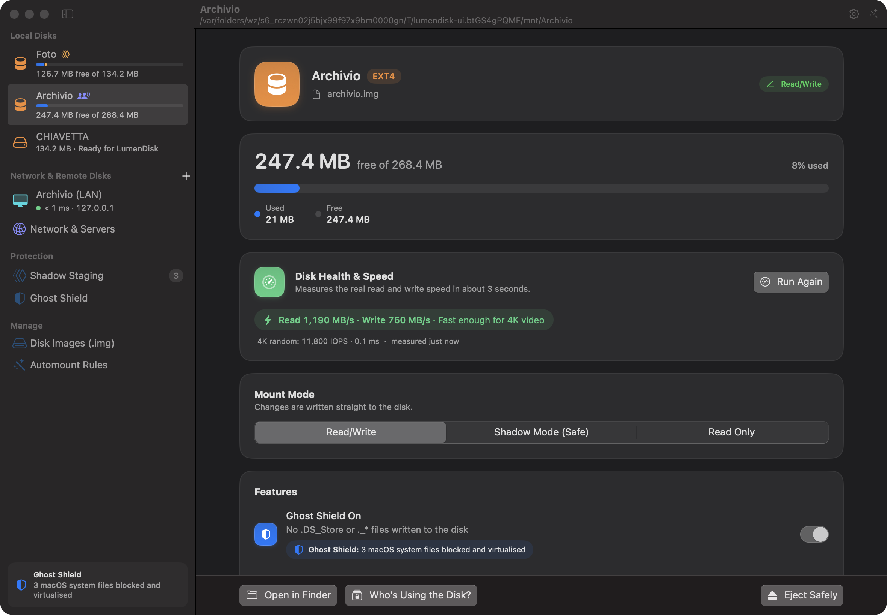
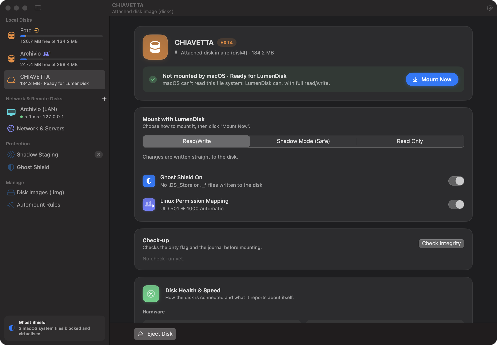
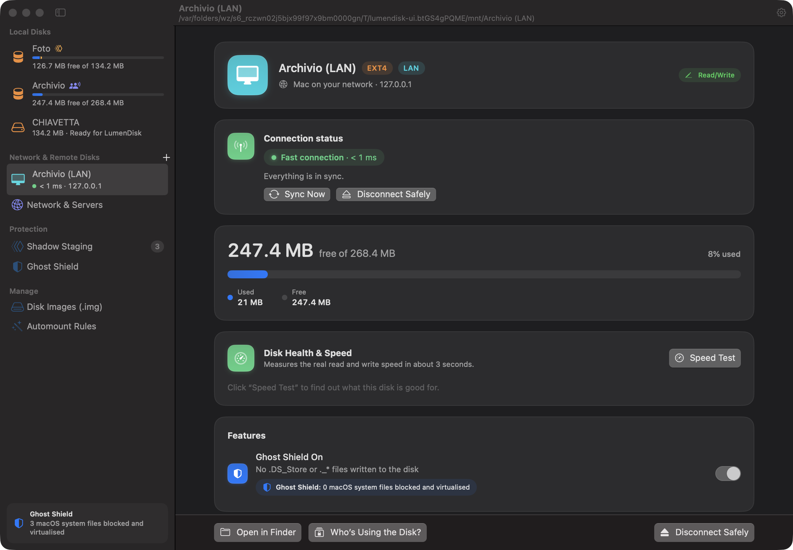
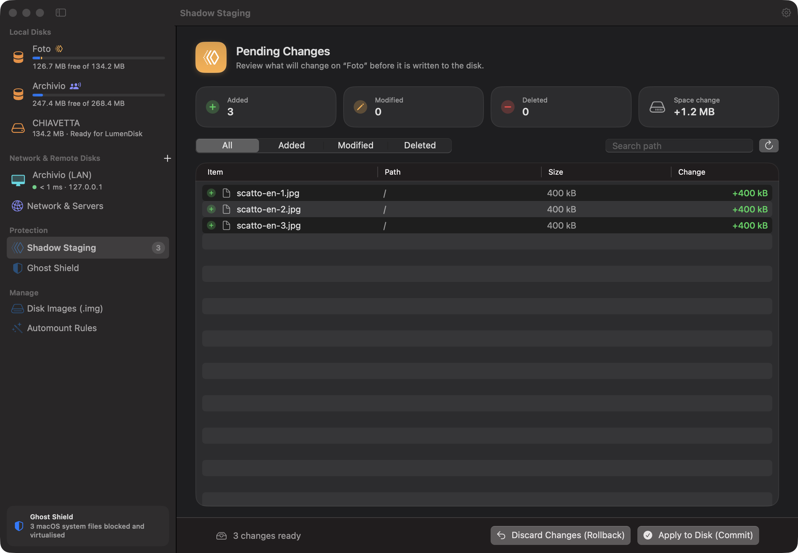
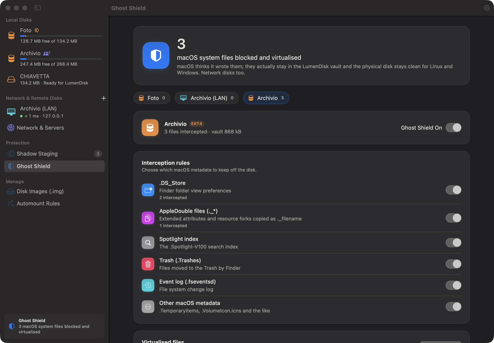
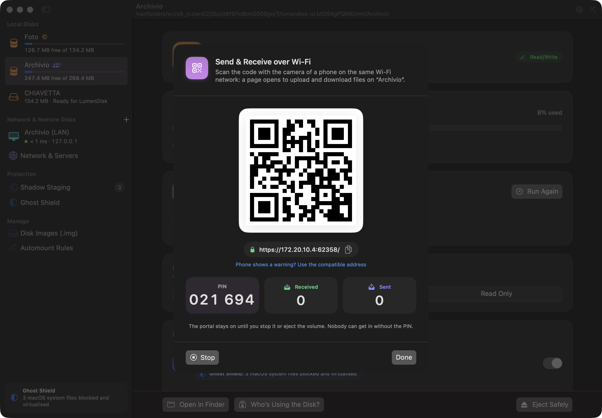
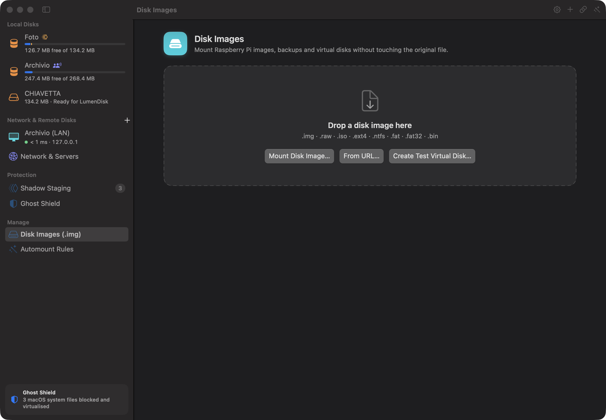
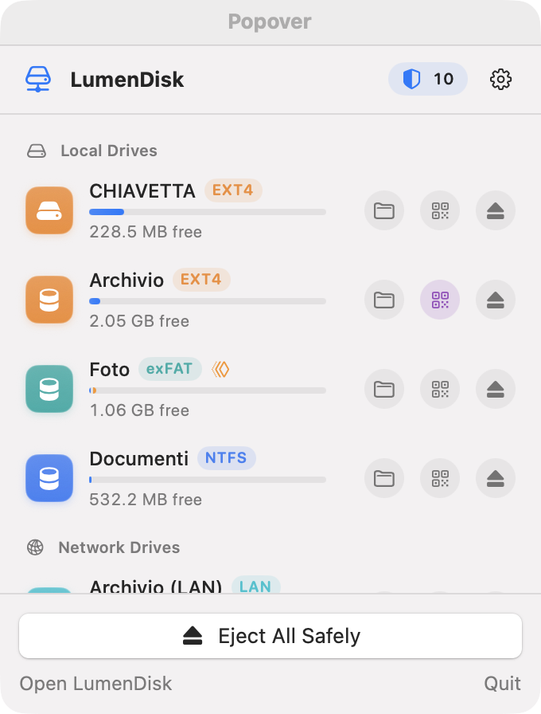

# LumenDisk

**English** | [Italiano](README.it.md)

<a href="https://paypal.me/giuseppegambino92"></a>

**Linux and Windows drives on your Mac, read and write, in Finder. No macFUSE, no kernel extensions, no Recovery-mode security changes.**


<p align="center">
  
</p>

LumenDisk mounts **ext2/ext3/ext4, NTFS, FAT12/16/32 and exFAT** drives, SD cards and disk images on macOS with full read/write access, so they behave like any other drive in Finder. It also mounts **SFTP servers, WebDAV/NAS shares, other Macs on your network** and **remote `.img` / `.iso` files** without downloading them.

Everything runs in user space: a Rust engine with its own filesystem drivers serves each volume to macOS through a private loopback NFS server, and macOS's own `mount_nfs` puts it in Finder. Nothing is installed in the kernel, and System Integrity Protection stays on.

## Download

Get the latest version from **[Releases](../../releases)**:

| File | For |
|---|---|
| **LumenDisk-1.0.0-universal.dmg** | **any Mac**: Apple Silicon and Intel (recommended) |
| LumenDisk-1.0.0-arm64.dmg | Apple Silicon only (M1, M2, M3, M4…) |
| LumenDisk-1.0.0-x86_64.dmg | Intel only |
| LumenDisk-1.0.0-universal.zip | the universal app, as a zip |
| lumendisk-cli-1.0.0-macos-universal.tar.gz | the `lumendisk` command-line tool |

Open the DMG and drag **LumenDisk** onto **Applications**. The app is signed with a Developer ID and notarized by Apple, so it opens like any other app. Checksums are in `SHA256SUMS.txt`.

Requires macOS 14 Sonoma or later.

## What it does

### Drives and images
- **Read/write ext2, ext3, ext4, NTFS, FAT12/16/32 and exFAT**, from USB, Thunderbolt and SD, or from disk images (`.img`, `.raw`, `.iso`, `.ext4`, `.ntfs`, `.fat32`).
- **Multi-partition images**: drop a Raspberry Pi image and mount `bootfs` (FAT32) and `rootfs` (ext4) side by side, ready to edit before flashing.
- **Drives macOS can't read** show up as *"Not mounted by macOS · Ready for LumenDisk"* with a one-click **Mount Now**.
- **Create test disks**: blank ext4, NTFS, FAT32 or exFAT images in one click.

### Protection
- **Ghost Shield**: `.DS_Store`, `._*` AppleDouble files, `.Spotlight-V100`, `.Trashes` and `.fseventsd` are kept in a local vault and never written to your Linux or Windows disk. Finder still works as usual.
- **Shadow Mode**: every change is staged on the Mac. Review the list of added, modified and deleted files, then **Commit** to the disk or **Rollback** to leave it untouched.
- **Crash-safe writes**: an ordered metadata journal (like ext4 `data=ordered`). If the Mac loses power mid-copy, the disk is repaired automatically at the next mount. Large copies are written only once (0.05 % journal overhead on ext4).
- **Linux permissions bridge**: files owned by your Linux user (e.g. `1000:1000`) look like yours on the Mac, and new files are saved with the Linux owner.
- **Dirty-bit & journal doctor**: detects volumes left dirty by Windows or Linux (dirty flag, hibernation, unreplayed ext4 journal) and repairs them in one click.
- **Who's using the disk?**: lists the apps keeping a volume busy and ejects it safely.

### Network and remote storage
- **SFTP, WebDAV and NAS mounts** that never freeze Finder: when the network drops, folders and already-opened files are served from a local cache in under a millisecond, writes are queued, and everything syncs when the connection returns, even after quitting the app.
- **Remote disk images** over HTTP or SFTP: a 600 MB Raspberry Pi image mounts in under half a second after downloading less than 1 % of it. Your changes stay on the Mac; the remote file is never modified.
- **Share a drive with another Mac** on your network in one click: Bonjour discovery, a pairing code, encrypted with TLS 1.3 and certificate pinning.
- **Send and receive over Wi-Fi**: scan a QR code with any phone to upload or download files directly to the external drive, protected by a PIN.

### Tools
- **Disk Health & Speed**: real read, write and 4K random speed in about 3 seconds, with a plain verdict ("Fast enough for 4K video"), plus SMART status, connection type and SSD/HDD.
- **Menu bar companion** with every drive, the Ghost Shield counter, quick Finder access, QR sharing and **Eject All Safely**.
- **Automount rules** per disk: read/write, read-only or Shadow, Ghost Shield and UID mapping.
- **Interface in English and Italian**, switchable at any time.

## Screenshots

| | |
|---|---|
|  |  |
| **Volume**: capacity, speed test, mount mode, Ghost Shield | **USB drive** macOS can't read, ready to mount |
|  |  |
| **Network disk** with connection health and offline queue | **Shadow Staging**: review changes, then Commit or Rollback |
|  |  |
| **Ghost Shield**: macOS junk kept off the disk | **Send & receive over Wi-Fi**: QR code and PIN |
|  |  |
| **Disk images**: drag & drop, URL, create a test disk | **Menu bar** companion |

All screenshots come from the real engine with real volumes (see [Verification](#verification)).

## Build from source

Requirements: Xcode with Swift 6, [rustup](https://rustup.rs). The `aarch64` and `x86_64` macOS targets are added automatically.

```sh
scripts/build_and_verify.sh                           # build, run every test suite, install to /Applications
SKIP_E2E=1 SKIP_UI=1 NO_INSTALL=1 scripts/build_and_verify.sh   # just build + unit tests
```

The script produces `dist/LumenDisk.app` (universal, ad-hoc signed) and `build/bin/lumendisk` (CLI). The end-to-end suites need Docker; the UI pass opens app windows.

To publish, `scripts/release.sh` signs that bundle with a Developer ID, notarizes it and builds the DMGs, the zip and the CLI archive in `dist/release/`. It uses the Apple account logged into Xcode, so no certificate or password setup is needed.

The command-line tool can create, inspect and mount images:

```sh
lumendisk mkfs ext4 test.img 512 MyDisk
lumendisk inspect raspios.img
lumendisk mount raspios.img --partition 2 --mode shadow
```

### Fuzzing

A USB stick or an image can be deliberately malformed, so every volume is treated as untrusted input. `scripts/fuzz.sh [seconds per target]` runs coverage-guided libFuzzer targets (`core/fuzz`: ext4, NTFS, FAT, exFAT and the MBR/GPT parser). Each input is a whole image that is mounted read-only and read-write, walked, modified and repaired. The seeds are images made by LumenDisk's own mkfs and, when Docker is available, by `mkfs.ext4 -d`, `mkfs.vfat` + `mcopy`, `mkntfs` + `ntfscp` and `mkfs.exfat`. It needs a nightly toolchain and cargo-fuzz (`rustup toolchain install nightly`, `cargo install cargo-fuzz`). If they're missing, it says so and skips. `build_and_verify.sh` runs it for 30 s per target when they are installed (`SKIP_FUZZ=1` skips it). Crashes are saved in `core/fuzz/artifacts/`. Once a crash is fixed, `cargo run --example fuzz_seeds -- core/tests/corrupt_regressions --regression <target> <file>` turns it into a small regression case that runs with every `cargo test`.

## How it works

```
Finder / any app
      │  macOS NFS client (built into every Mac)
      ▼
mount_nfs 127.0.0.1:/<random export>  →  ~/Volumes/<Name>
      │
      ▼  private loopback NFSv3 server, one per volume
┌──────────────────────────── lumendisk-core (Rust) ────────────────────────────┐
│ Ghost Shield → Shadow overlay → UID bridge → ordered WAL → ext4 / NTFS / FAT / exFAT │
│                                         └→ or a remote backend: SFTP · WebDAV · LAN  │
└────────────────────────────────────────────────────────────────────────────────────┘
      │  image file, /dev/diskN (via authopen), or HTTP/SFTP byte ranges
```

- **Filesystem drivers** are written from scratch in Rust: extent trees, htree directories, `metadata_csum` and jbd2 journal replay for ext4; MFT, B-tree indexes, reparse points and LZNT1 for NTFS; VFAT long names for FAT; allocation bitmap and up-case table for exFAT.
- **The loopback server** listens on 127.0.0.1 only. It uses a random export path, accepts a single MOUNT handshake and puts a 128-bit secret in every file handle, and it rejects calls from other users.
- **The Swift app** talks to the engine through a small C ABI (`core/include/lumendisk_ffi.h`) and uses DiskArbitration for drive discovery.

## Verification

`scripts/build_and_verify.sh` builds everything and proves it works against independent, upstream tools running in Docker (e2fsprogs, ntfs-3g, dosfstools, exfatprogs, OpenSSH, Apache):

| Suite | What it proves |
|---|---|
| Unit (89) | every driver passes the same conformance suite; WAL crash replay; Ghost Shield; Shadow; remote cache races; a driver panic fails only its volume, fast (EIO), without poisoning locks |
| ext4 vs e2fsprogs (5) | real `mkfs.ext4` volumes (64bit, flex_bg, metadata_csum, orphan_file) modified by LumenDisk stay `e2fsck`-clean; jbd2 replay of a real transaction |
| End-to-end (24) | real `mount_nfs` + Finder's NFS client on ext4 / FAT32 / exFAT / NTFS; Shadow; Doctor; Raspberry Pi image; NTFS symlinks; loopback security; HTTP Range images; offline LAN shares; SFTP; power loss with a 64 MB file; Apache WebDAV with offline queue across restarts; TLS through a sniffing proxy (no plaintext); a real attached block device |
| Corrupted images (16,000 mutants + regressions) | valid, populated volumes (ext2/ext4 with extents, htree, symlinks and a pending journal transaction; NTFS with index blocks, attribute lists, LZNT1-compressed files and reparse points; FAT12/16/32; exFAT) mutated with a bias towards metadata, plus mutated MBR/GPT tables and every bug found as a regression case: each mutant is mounted read-only and read-write, walked, modified and repaired with no panic, no hang (20 s limit) and no allocation over 1 GiB. A driver panic disables only that volume (EIO from then on) and never wedges it. `LUMENDISK_CORRUPT_CASES` raises the count |
| LAN server (21) · SFTP (4) | WebDAV/portal protocol over TLS; OpenSSH auth, timeouts and reconnects |
| UI | every screen driven with the real engine and real volumes, in English and Italian |

## Known limitations

- Volumes appear in `~/Volumes/<Name>`, because an app without administrator rights can't create folders in `/Volumes`.
- Remote volumes can't open files offline that were never opened while online; they fail quickly instead of hanging.
- The Wi-Fi portal's HTTPS address shows a one-time certificate warning on phones. The compatibility HTTP address avoids it but isn't encrypted.
- NTFS: compressed and encrypted files are read-only; not yet verified against Windows `chkdsk`.
- ext4 volumes using inline_data, encryption, casefold, bigalloc, quota or verity mount read-only.
- Most USB bridges hide SMART data from macOS; LumenDisk then says so plainly.

## Support

If LumenDisk is useful to you, you can support its development:

<a href="https://paypal.me/giuseppegambino92"></a>

---

© Giuseppe Gambino. The bundled NFSv3 server in `vendor/nfsserve` is BSD-3-Clause (XetData / Hugging Face).
